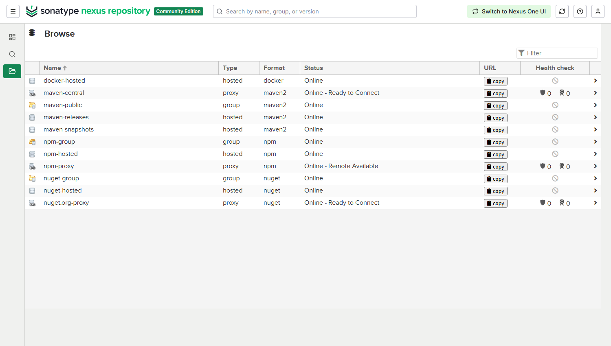
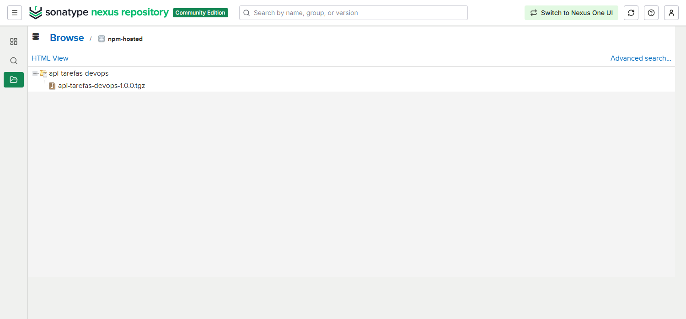
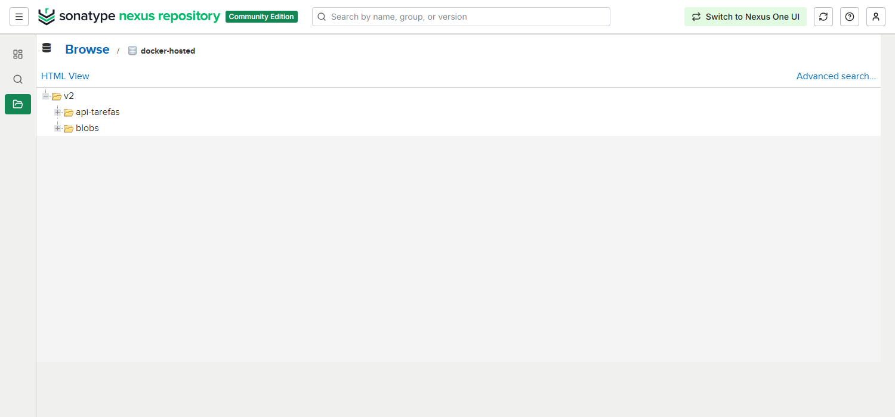

# Prática: Nexus Repository

**Aluno:** Daniel Lucas Andrade de Souza

Prática de **gestão de artefatos** com o **Sonatype Nexus Repository (Community Edition)** rodando em Docker. O Nexus guarda em um só lugar os artefatos produzidos pela equipe (pacotes e imagens Docker) e faz cache das dependências baixadas da internet.

O artefato usado é a **API de Tarefas** do repositório [api-tarefas-devops](https://github.com/danlucas0/api-tarefas-devops), publicada no Nexus de duas formas: como **pacote npm** e como **imagem Docker**.

## O que é um repositório de artefatos

| Tipo | Função | Nesta prática |
|---|---|---|
| **hosted** | Guarda artefatos produzidos pela própria equipe | `npm-hosted`, `docker-hosted` |
| **proxy** | Espelho/cache de um repositório externo | `npm-proxy` → registry.npmjs.org |
| **group** | Junta vários repositórios em um único endereço | `npm-group` = `npm-hosted` + `npm-proxy` |

Vantagens: versões dos artefatos controladas pela empresa, builds mais rápidos (cache), menos dependência da internet e um ponto único de onde os servidores baixam o que vai para produção.

## Estrutura

| Arquivo | Função |
|---|---|
| `docker-compose.yml` | Sobe o Nexus (porta 8081 = web/npm, 8082 = registry Docker) |
| `scripts/configurar-nexus.sh` | Configura o Nexus pela API REST: senha do admin, realms, acesso anônimo e criação dos repositórios |

## Passo a passo

### 1. Subir o Nexus

```bash
docker compose up -d
```

A primeira inicialização leva de 2 a 3 minutos. Interface: **http://localhost:8081**

### 2. Configurar (configuração como código)

```bash
bash scripts/configurar-nexus.sh
```

O script lê a senha inicial do admin de dentro do container, troca para `admin123`, ativa os realms de token do npm e do Docker e cria os repositórios `npm-hosted`, `npm-proxy`, `npm-group` e `docker-hosted`.



### 3. Publicar a API como pacote npm

Na pasta da API (`api-tarefas-devops`), com um `.npmrc` apontando para o Nexus:

```ini
registry=http://localhost:8081/repository/npm-group/
//localhost:8081/repository/npm-hosted/:_auth=YWRtaW46YWRtaW4xMjM=
//localhost:8081/repository/npm-group/:_auth=YWRtaW46YWRtaW4xMjM=
```

```bash
npm publish --registry http://localhost:8081/repository/npm-hosted/
```



Teste do **group**: em outro projeto, `npm install api-tarefas-devops` usando o `npm-group`. O pacote da API veio do `npm-hosted` e as dependências (express etc.) vieram do `npm-proxy`, que ficou com cache delas.

### 4. Publicar a API como imagem Docker

```bash
docker build -t localhost:8082/api-tarefas:1.0.0 .
docker tag localhost:8082/api-tarefas:1.0.0 localhost:8082/api-tarefas:latest
docker login localhost:8082 -u admin
docker push localhost:8082/api-tarefas:1.0.0
docker push localhost:8082/api-tarefas:latest
```



### 5. Usar o artefato publicado

Apagando a imagem local e baixando do Nexus:

```bash
docker run -d -p 3000:3000 localhost:8082/api-tarefas:1.0.0
curl http://localhost:3000/health
# {"status":"ok","versao":"dev"}
```

## Resultado

- ✅ Nexus rodando em container Docker
- ✅ Repositórios **hosted**, **proxy** e **group** (npm) e **docker-hosted** criados via script
- ✅ API publicada como pacote npm `api-tarefas-devops@1.0.0`
- ✅ API publicada como imagem Docker `api-tarefas:1.0.0` e `latest`
- ✅ Imagem baixada do Nexus e executada com sucesso (`/health` respondendo)

## Relação com o pipeline

No pipeline da prática anterior, o GitHub Actions publica a imagem no **GHCR**. Em uma empresa com Nexus, o passo de publicação apontaria para o Nexus (`docker push nexus.empresa.com/api-tarefas`) e os servidores baixariam a imagem de lá. O fluxo continua o mesmo, só muda o repositório de artefatos.
